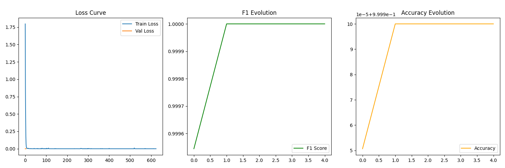
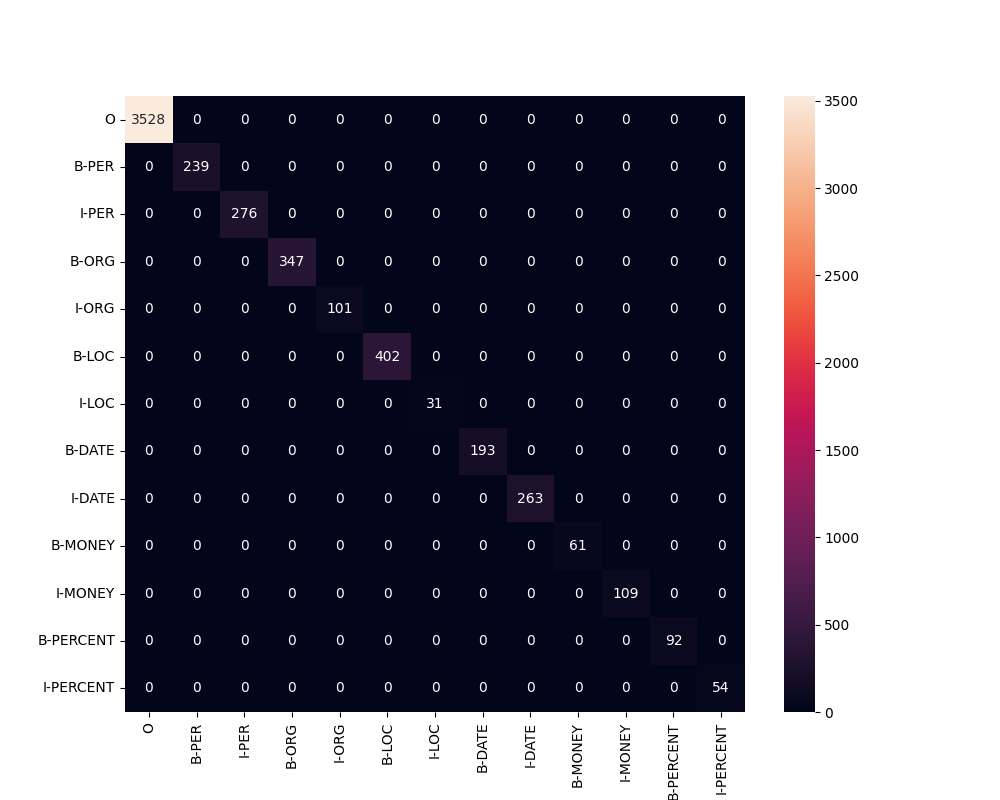

# Türkçe Haber Metinlerinde Akıllı Varlık Tanıma

**BERTurk tabanlı derin öğrenme, kendi oluşturduğumuz etiketli veriler ve Türkçeye özel kurallarla haber metinlerini yapılandırılmış bilgiye dönüştüren doğal dil işleme projesi.**

Bu projede, Türkçe haberlerde geçen kişi, kurum, yer, tarih, para ve yüzde ifadelerini otomatik olarak belirleyen uçtan uca bir **Adlandırılmış Varlık Tanıma — Named Entity Recognition (NER)** sistemi geliştirdik. Veri oluşturma, BIO etiketleme, eğitim verisi hazırlama, önceden eğitilmiş bir dil modelini kendi verilerimizle ince ayarlama, başarı ölçümü ve kullanıcı arayüzünde sonuçları görselleştirme aşamalarını aynı proje içinde bir araya getirdik.

Çalışmanın temel katkısı, bir modeli yalnızca tahmin amacıyla kullanmanın ötesine geçerek **kendi eğitim verimizi üreten ve bu verilerle Türkçe haber alanına uyarlanan bir öğrenme süreci kurmamızdır.** BERTurk'un dil bilgisini, proje kapsamında hazırladığımız örnekler ve Türkçe metinlerin ihtiyaçlarına yönelik son işleme adımlarıyla birleştirdik.

## Proje hangi problemi çözüyor?

Haber metinleri büyük ölçüde serbest metin biçimindedir. Bir haberde kimden söz edildiğini, hangi kurumların yer aldığını, olayın nerede gerçekleştiğini ve hangi tarih ya da tutarların geçtiğini otomatik olarak çıkarmak; arama, arşivleme, medya takibi ve bilgi çıkarımı için önemli bir adımdır.

Sistemimiz, kullanıcının girdiği haber metni üzerinde varlıkları bulur; her varlığın türünü, model güven skorunu ve metindeki başlangıç–bitiş konumunu üretir. Streamlit arayüzü bu çıktıları renkli vurgular, varlık listeleri ve dağılım grafiği ile sunar.

Örneğin aşağıdaki metin:

> Ayşe Yılmaz, Ankara'da ASELSAN tarafından 29 Ekim tarihinde açıklanan 100 milyon TL değerindeki yatırımı değerlendirdi.

şu tür bilgilerin çıkarılması için kullanılabilir:

| Varlık türü | Açıklama | Metindeki örnek |
| --- | --- | --- |
| `PER` | Kişi | Ayşe Yılmaz |
| `ORG` | Kurum / organizasyon | ASELSAN |
| `LOC` | Yer / konum | Ankara'da |
| `DATE` | Tarih / zaman ifadesi | 29 Ekim |
| `MONEY` | Parasal ifade | 100 milyon TL |
| `PERCENT` | Yüzde / oran ifadesi | yüzde 20 |

Bu tablo, desteklenen sınıfları açıklayan bir kullanım örneğidir; belirli bir metinde alınmış ölçülmüş tahmin çıktısı değildir.

## Kendi verilerimizi nasıl oluşturduk?

### 1. Haber alanına yönelik sentetik veri üretimi

Projede kendi etiketli veri setimizi oluşturmak için Python ile şablon tabanlı veri üretim araçları geliştirdik. Kişi, kurum, konum, tarih, para ve yüzde ifade havuzlarını; siyaset, diplomasi, ekonomi, finans, savunma ve teknoloji bağlamındaki cümle şablonlarıyla birleştirdik.

Veri üretiminde ele aldığımız başlıca konular:

- **Çok kelimeli varlıklar:** “Türk Hava Yolları”, “İstanbul Teknik Üniversitesi” ve “Recep Tayyip Erdoğan” gibi ifadeler.
- **Türkçe çekim ekleri:** “Ankara'da” ve “İstanbul'a” gibi kullanımlar için ünlü uyumu, kaynaştırma ve belirli ünsüz kurallarını kullanan ek üretimi.
- **Farklı ifade biçimleri:** Sayısal ve yazıyla belirtilen tarihler, parasal değerler ve oranlar.
- **Negatif örnekler:** Varlık içermediği kabul edilerek `O` etiketi verilen cümlelerle gereksiz varlık tahminini azaltmayı hedefleyen örnekler.
- **Otomatik etiketleme:** Üretilen cümlelerdeki varlıkların token düzeyinde BIO etiketlerine dönüştürülmesi.

`generate_professional_data.py`, `AdvancedDataGenerator` sınıfını kullanır. Yapılandırmada **25.000 örnek** ve **%25 negatif örnek seçme olasılığı** tanımlıdır. Bu olasılık, son veri setinde benzersiz negatif cümlelerin %25 olduğu anlamına gelmez; aynı negatif şablonlar tekrar seçilebilir.

Mevcut `data/processed/` dosyalarının örnek sayıları:

| Bölüm | Örnek sayısı | Oran |
| --- | ---: | ---: |
| Eğitim | 20.000 | %80 |
| Doğrulama | 2.500 | %10 |
| Test | 2.500 | %10 |
| **Toplam** | **25.000** | **%100** |

Ayrıca `create_dataset.py` içinde 20.000 örnek hedefleyen alternatif bir üretim akışı bulunur. Bu akış; yinelenen cümle kontrolü, farklı çekim ekleri ve belirli bir olasılıkla küçük harfe dönüştürme uygular. Depoda `data/csv_dataset/generated/` altında 16.000 eğitim, 2.000 doğrulama ve 2.000 test örneğinden oluşan ayrı dosyalar da yer alır.

### 2. CSV veri kaynağı ve hibrit veri hazırlama

Projede `turkish_news_ner_1000.csv` adlı **1.000 kayıtlık yapılandırılmış bir veri kaynağı** bulunur. Bu dosya; siyaset, ekonomi, finans, teknoloji, spor, sağlık, eğitim, diplomasi, güvenlik ve yerel haber kategorilerindeki örnekleri içerir.

| Alan | İçerik |
| --- | --- |
| `id` | Kayıt kimliği |
| `category` | Haber kategorisi |
| `text` | Haber metni |
| `tokens` | JSON biçiminde token listesi |
| `tags` | Tokenlarla eşleşen BIO etiketleri |
| `entities` | Varlık metinleri ve sınıfları |

`prepare_hybrid_data.py`, CSV kayıtlarını Pandas ile okuyup `tokens` ve `tags` alanlarını JSON listelerine dönüştürür. Ardından bu kayıtları sentetik örneklerle birleştirerek yaklaşık **%70 sentetik + %30 CSV kaynaklı** bir havuz oluşturmayı hedefler.

Mevcut hibrit veri dosyaları ve kayıtlı veri raporu birbiriyle uyumludur:

| Bölüm | Örnek sayısı |
| --- | ---: |
| Eğitim | 2.666 |
| Doğrulama | 333 |
| Test | 334 |
| **Toplam** | **3.333** |

Hibrit hazırlama kodu, eğitim kümesiyle birebir aynı olan cümleleri doğrulama ve test kümelerinden çıkarır. Bu kontrol tam metin eşitliğine dayanır; benzer şablonları veya anlamsal olarak yakın cümleleri ayıran bir denetim değildir. CSV dosyasının özgün kaynağı ve toplama yöntemi mevcut dosyalarda belgelenmediğinden, bu kayıtlar bağımsız olarak doğrulanmış gerçek haber korpusu şeklinde sunulmamaktadır.

### 3. Veri saklama ve veritabanı yaklaşımı

Projenin mevcut veri katmanı **CSV ve CoNLL dosyalarına dayalıdır**. Haber metinleri, kategoriler ve etiketler CSV içinde; eğitime hazır token–etiket dizileri ise CoNLL biçimindeki metin dosyalarında saklanır. Böylece veri hazırlama ile model eğitimi arasında açık ve incelenebilir bir veri akışı kurulur.

Mevcut uygulamada SQLite, PostgreSQL, MySQL veya MongoDB bağlantısı bulunmaz. Bu nedenle kullanılan yapı, dosya tabanlı bir veri havuzu olarak tanımlanır. Çıkarılan varlıkların ilişkisel bir veritabanına kaydedilmesi ve sorgulanması, projenin geliştirilebilecek sonraki adımlarından biridir.

## BIO etiketleme ve veri biçimi

Model, altı varlık sınıfını **13 token etiketi** ile öğrenir:

```text
O
B-PER      I-PER
B-ORG      I-ORG
B-LOC      I-LOC
B-DATE     I-DATE
B-MONEY    I-MONEY
B-PERCENT  I-PERCENT
```

`B-` bir varlığın başlangıcını, `I-` aynı varlığın devamını, `O` ise varlık dışında kalan tokenları belirtir. Örneğin:

```text
Türk B-ORG
Hava I-ORG
Yolları I-ORG
yeni O
yatırımını O
açıkladı O
. O
```

CoNLL dosyalarında her satır bir token ve etiketini içerir; cümleler boş satırlarla ayrılır. Bu yapı, çok kelimeli varlıkların sınırlarını model eğitimine taşır.

## Model mimarisi ve eğitim süreci

Temel dil modeli olarak **`dbmdz/bert-base-turkish-cased`** kullanılır. Büyük/küçük harf ayrımını koruyan bu model, Hugging Face `AutoModelForTokenClassification` aracılığıyla NER görevine uyarlanır. Projede yapılan eğitim, önceden eğitilmiş BERTurk ağırlıklarını kendi etiketli verilerimiz üzerinde **ince ayarlama — fine-tuning** işlemidir.

Depodaki model yapılandırması 12 Transformer katmanı, 12 attention head, 768 boyutlu gizli temsiller ve 32.000 tokenlık sözlük içerir. Token sınıflandırma katmanı, her alt token için 13 etikete karşılık gelen skorlar üretir.

Eğitim akışı şu adımlardan oluşur:

1. CoNLL dosyalarından cümleler ve BIO etiketleri okunur.
2. Tokenizer, kelimeleri modelin alt tokenlarına dönüştürür.
3. `word_ids()` ile her alt tokenın kaynak kelimesi bulunur ve ilgili etiket hizalanır.
4. Özel tokenlar `-100` etiketiyle kayıp hesabı dışında bırakılır; padding etiketleri de veri birleştirici tarafından yönetilir.
5. PyTorch veri kümesi ve `DataCollatorForTokenClassification` üzerinden eğitim girdileri hazırlanır.
6. Hugging Face `Trainer` ile eğitim yürütülür; her epoch sonunda doğrulama yapılır.
7. Doğrulama F1 skoruna göre en iyi checkpoint seçilir; erken durdurma uygulanır.
8. Model ağırlıkları ve tokenizer, uygulamanın okuyacağı `model/` klasörüne kaydedilir.

Mevcut hizalama yaklaşımı, bir kelimenin etiketini o kelimenin tüm alt tokenlarına kopyalar. Dolayısıyla raporlanan sonuçlar bu etiketleme tercihiyle birlikte değerlendirilmelidir.

### Eğitim yapılandırmaları

Projede iki ayrı güncel eğitim yolu bulunur:

| Ayar | Modüler eğitim: `src/training/trainer.py` | Hibrit eğitim: `train.py` |
| --- | --- | --- |
| Veri kaynağı | `data/processed/` | `data/hybrid/` |
| Öğrenme oranı | `3e-5` | `3e-5` |
| Eğitim batch boyutu | 16 | 16 |
| Üst epoch sınırı | 10 | 15 |
| Weight decay | 0,1 | 0,1 |
| Hidden dropout | 0,2 | 0,2 |
| Attention dropout | Temel model ayarı | 0,2 |
| Warmup oranı | Trainer'a aktarılmıyor | 0,1 |
| Erken durdurma sabrı | 3 değerlendirme | 3 değerlendirme |
| En iyi model ölçütü | F1 | F1 |
| Karma hassasiyet | CUDA varsa FP16 | CUDA varsa FP16 |

`config.py` içinde `MAX_LENGTH=128` ve `WARMUP_RATIO=0.1` tanımlıdır; ancak modüler eğitim kodu bu değerleri ilgili çağrılara açıkça aktarmamaktadır. Tokenizer çağrısında `truncation=True` kullanılır. Belgelenen ayarlar, tanımlı değerler ile eğitimde gerçekten kullanılan değerleri bu nedenle ayrı gösterir.

## Tahmin ve Türkçeye özel son işleme

Streamlit uygulaması, `AdvancedNERPipeline` sınıfını kullanır. Bu katman model tahminlerini aşağıdaki işlemlerle düzenler:

- **Alt token gruplama:** Hugging Face NER pipeline'ındaki `aggregation_strategy="simple"` ile varlık parçalarını gruplar.
- **Yakın varlıkları birleştirme:** Aynı türdeki tahminleri, aradaki karakter sayısı en fazla iki olduğunda birleştirir.
- **Güven eşiği:** Varsayılan `0.60` eşiğinin altındaki tahminleri filtreler; para ve tarih kalıplarına uyan adaylar için istisna uygular.
- **Kural tabanlı düzeltme:** Para, yıl, sayısal tarih, ay adı, süre ve belirli ürün anahtar kelimelerine göre aday etiketlerini yeniden değerlendirir.
- **Unvan filtreleme:** Tek başına bulunan belirli unvanların kişi veya kurum olarak sunulmasını engellemeyi hedefler.
- **Karakter konumlarıyla çıktı:** Varlık metnini özgün girdinin başlangıç ve bitiş konumlarından alır; örtüşen sonuçları filtreler.

Temel modelin eğitim sınıfları altı tanedir. Arayüzde ayrıca gösterilebilen **`URUN` ve `DURATION`**, bağımsız olarak öğrenilmiş model sınıfları değildir; son işleme kurallarının mevcut adaylara atayabildiği etiketlerdir. Kurallar bütün metni tarayarak sıfırdan varlık üretmez; modelin bulduğu adaylar üzerinde çalışır.

`predict.py` ise doğrudan Hugging Face pipeline'ını kullanan ayrı bir terminal arayüzüdür; Streamlit uygulamasındaki ek son işleme katmanını çalıştırmaz.

## Başarı ölçümü ve mevcut sonuçlar

Eğitimde `evaluate` üzerinden `seqeval` kullanılarak precision, recall, F1 ve token accuracy hesaplanır. Hibrit eğitim kodu ayrıca token etiketleri üzerinde ağırlıklı F1 üretir.

Depodaki `outputs/metrics.txt` dosyasında şu sonuçlar kayıtlıdır:

| Ölçüt | Kayıtlı değer |
| --- | ---: |
| Accuracy | 1,0000 |
| F1 | 1,0000 |
| Weighted F1 | 1,0000 |

**Bu değerler mevcut doğrulama değerlendirmesine aittir.** `train.py`, son ölçüm için `dev.txt` üzerinden hazırlanan veriyi `trainer.predict()` çağrısına verir. Kütüphanenin sonuç anahtarlarında `test_` öneki kullanması, ayrılmış `test.txt` dosyasının değerlendirildiği anlamına gelmez.

Şablon tabanlı örneklerde benzer cümle yapılarının farklı bölümlerde bulunması başarı skorlarını yükseltebilir. Sonuçlar, açık alan haberlerinde kusursuz başarı iddiası olarak yorumlanmamalıdır. Daha güçlü bir genelleme değerlendirmesi için şablon ve varlık bazında ayrılmış kümeler ile bağımsız, insan denetimli haber örnekleri kullanılabilir. Bu dokümantasyon hazırlanırken model yeniden eğitilmemiş; mevcut kod, veri dosyaları ve kayıtlı eğitim çıktıları incelenmiştir.

### Projede yer alan görseller





Grafikler depodaki kayıtlı çıktılardır. Birden fazla eğitim akışı aynı çıktı klasörlerini kullandığından, bütün görsellerin aynı eğitim çalışmasına ait olduğu varsayılmamalıdır.

## Uygulama arayüzü

Streamlit arayüzünde kullanıcı haber metnini girer ve **Analiz Et** düğmesiyle tahmin sürecini başlatır. Sonuç ekranı:

- Varlıkları türlerine göre renkli olarak işaretler.
- Her tahminin model güven skorunu gösterir.
- Tespit edilen varlıkları liste halinde sunar.
- Varlık türlerinin adetlerini sütun grafiğinde gösterir.
- **Sıfırla** düğmesiyle yeni bir analiz için oturumdaki sonuçları temizler.

Model yüklemesi `st.cache_resource` ile önbelleğe alınır. Uygulama önce `model/` klasörünü, bu klasör yoksa `results/checkpoint-6250` yolunu kontrol eder.

## Kullanılan teknolojiler

| Teknoloji | Projedeki rolü |
| --- | --- |
| Python | Veri hazırlama, eğitim ve uygulama geliştirme |
| PyTorch | Model eğitimi ve tensör işlemleri |
| Hugging Face Transformers | BERTurk, tokenizer, Trainer ve NER pipeline |
| BERTurk | Türkçe bağlamsal dil temsilleri |
| Pandas / NumPy | Veri okuma ve sayısal işlemler |
| Evaluate / Seqeval | NER değerlendirme ölçütleri |
| Scikit-learn | Ağırlıklı F1 ve karışıklık matrisi |
| Matplotlib / Seaborn | Veri ve eğitim görselleştirmeleri |
| Streamlit | Etkileşimli web arayüzü |
| CSV / JSON / CoNLL | Yapılandırılmış kayıtlar ve eğitim verisi biçimleri |

## Kurulum ve kullanım

Aşağıdaki komutlar depo kökünden başlayıp uygulama klasörüne geçecek şekilde verilmiştir. Göreli veri ve model yollarının doğru çözülmesi için Python komutlarını `ner_project/` içinde çalıştırın.

```powershell
cd ner_project
python -m venv .venv
.\.venv\Scripts\Activate.ps1
python -m pip install -r requirements.txt
python -m pip install accelerate
```

`accelerate`, Trainer tabanlı eğitim için kurulum adımına dahil edilmiştir; mevcut `requirements.txt` içinde açıkça listelenmez. Kaydedilmiş model yapılandırmasında Transformers sürümü `4.53.0` olarak görünür; bağımlılık dosyası sürümleri sabitlemediği için farklı ortamlarda API uyumluluğu ayrıca kontrol edilmelidir.

### Web arayüzünü başlatma

```powershell
streamlit run app.py
```

Bu işlem için tokenizer dosyalarını ve eğitilmiş ağırlıkları içeren `model/` klasörü gerekir. Model dosyaları dağıtıma dahil edilmemişse önce aşağıdaki eğitim akışlarından biri tamamlanmalıdır.

### Kendi verisini üretip modüler modeli eğitme

```powershell
python generate_professional_data.py
python -m src.training.trainer
```

İlk komut `data/processed/` altındaki eğitim, doğrulama ve test dosyalarını yeniden üretir. İkinci komut BERTurk'u bu veriler üzerinde eğitir ve modeli `model/` klasörüne kaydeder. Temel modelin ve değerlendirme bileşenlerinin ilk yüklenmesinde internet bağlantısı gerekebilir.

### Alternatif hibrit eğitim akışı

```powershell
python create_dataset.py
python prepare_hybrid_data.py
python train.py
```

`create_dataset.py`, hibrit hazırlama kodunun beklediği `data/generated/` dosyalarını oluşturur. Depodaki `data/csv_dataset/generated/` klasörü farklı bir yoldur ve hibrit hazırlama betiği tarafından doğrudan okunmaz.

**`train.py` başlangıçta `model/`, `results/` ve `logs/` klasörlerini silip yeniden oluşturur; ayrıca belirli rapor dosyalarını temizler. Bu akışı çalıştırmadan önce korunacak eğitim çıktılarını yedekleyin.**

### Terminalden tahmin

```powershell
python predict.py
```

Terminal uygulamasında haber metni girerek model çıktıları incelenebilir. Çıkmak için `q` yazılır.

## Proje yapısı

```text
.
├── README.md
├── doğal_dil_işleme_raporu.docx
└── ner_project/
    ├── app.py                         # Streamlit arayüzü
    ├── config.py                      # Model, etiket ve veri üretim ayarları
    ├── generate_professional_data.py  # 25.000 örnek hedefleyen veri üretimi
    ├── create_dataset.py              # Alternatif sentetik veri üretimi
    ├── prepare_hybrid_data.py         # CSV + sentetik veri birleştirme
    ├── train.py                       # Hibrit veriyle eğitim ve değerlendirme
    ├── train1.py                      # Önceki üç varlık sınıflı eğitim sürümü
    ├── predict.py                     # Terminal üzerinden model tahmini
    ├── requirements.txt
    ├── src/
    │   ├── preprocessing/data_generator.py
    │   ├── training/trainer.py
    │   ├── inference/pipeline.py
    │   └── visualization/reports.py
    ├── data/
    │   ├── csv_dataset/
    │   ├── processed/
    │   └── hybrid/
    ├── model/                         # Eğitilmiş ağırlıklar ve tokenizer
    ├── results/                       # Eğitim checkpoint'leri
    ├── logs/                          # Eğitim kayıtları
    └── outputs/                       # Metrikler ve grafikler
```

## Geliştirme yönleri

Sonraki aşamalarda çıkarılan varlıklar için veritabanı entegrasyonu, uzun haberlerde örtüşen pencerelerle çıkarım, insan denetimli etiket kontrolü, şablon bazında veri ayrımı ve bağımlılık sürümlerinin sabitlenmesi eklenebilir. Mevcut tahmin kodunda uzun metinler için açık bir pencereleme mekanizması bulunmaz; modelin bağlam sınırı dikkate alınmalıdır.

GitHub paylaşımında kaynak kod, veri hazırlama araçları ve raporlar birlikte sunulabilir. Yerel sanal ortamlar ile tekrarlanan eğitim checkpoint'leri kaynak koddan ayrı tutulmalıdır. Yaklaşık 440 MB boyutundaki model ağırlıkları için Git LFS veya ayrı bir model dağıtım alanı kullanılabilir.

## GitHub kısa proje açıklaması

> BERTurk tabanlı Türkçe haber NER sistemi: kendi ürettiğimiz BIO etiketli verilerle model eğitimi, CSV destekli hibrit veri hazırlama, Türkçeye özel son işleme ve Streamlit ile etkileşimli varlık analizi.
